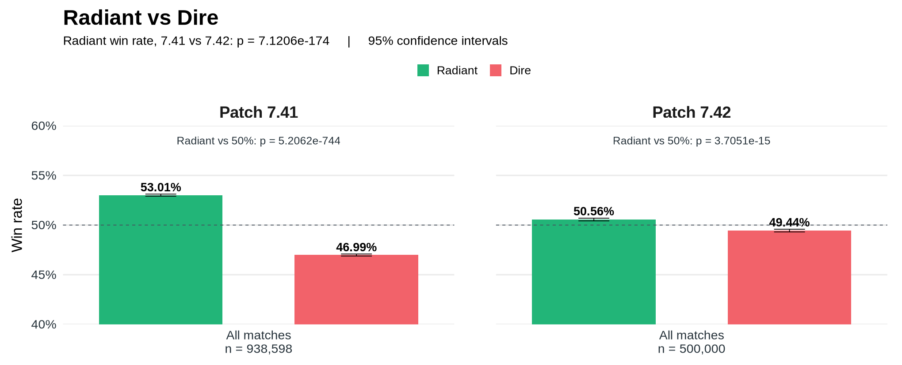
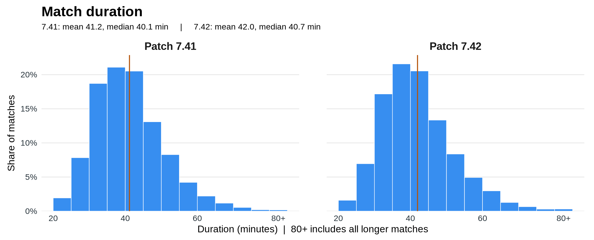
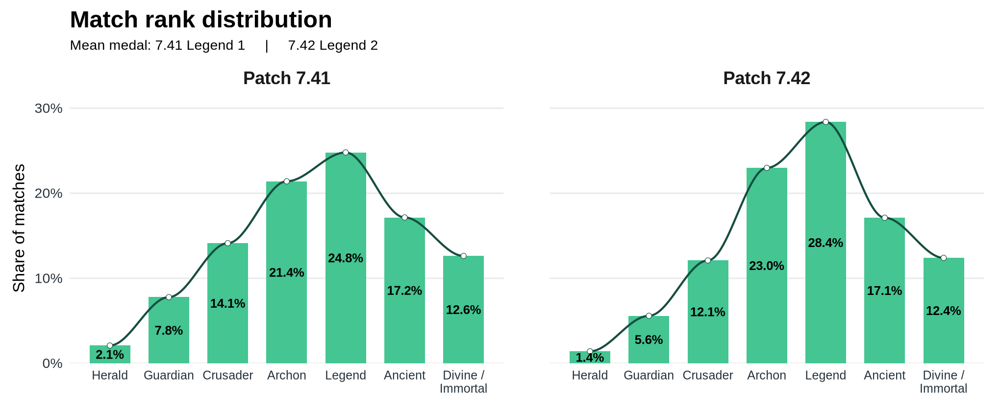
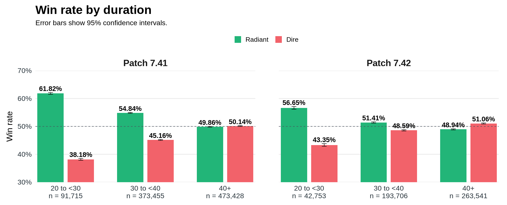
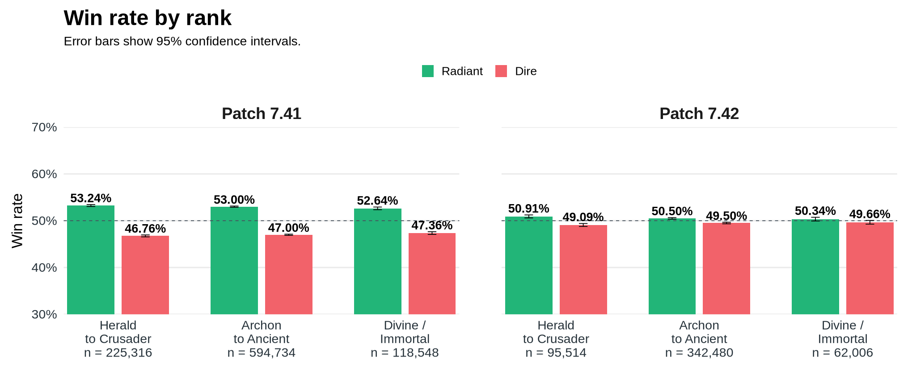

## Abstract

This study compares Radiant and Dire win rates in two patch-labelled Dota 2 ranked-match
samples. After filtering, 938,598 matches in patch 7.41 and 500,000 in patch 7.42 were retained.
Radiant win rates were 53.01% and 50.56%, respectively. The observed side-to-side gap narrowed
from 6.03 to 1.11 percentage points. Both samples depart from equal win rates under the
original binomial test assumptions. Duration and rank stratification provide descriptive
context; unequal sampling periods and possible dependence between matches limit causal and
population-level conclusions.

## Data and methods

The original analysis uses OpenDota public matches and restricts the sample to ranked
lobbies, at least 20 minutes in duration, recognized match IDs and outcomes, and selected
average-rank tier codes. The file names provide the patch labels. Exact duplicate rows
are removed, and conflicting match IDs or cross-sample overlap trigger an error.
See [data documentation](data/README.md) for the complete filter and variable definitions.

| Patch | First observed match (UTC) | Last observed match (UTC) | Eligible matches |
| --- | --- | --- | ---: |
| 7.41 | 2026-09-13 07:17:31 | 2026-09-23 06:48:18 | 938,598 |
| 7.42 | 2026-11-22 19:30:58 | 2026-11-23 23:33:38 | 500,000 |

Within each patch, a two-sided exact binomial test evaluates the null hypothesis of a 50%
Radiant win rate. A two-proportion test without continuity correction compares the patch
samples. Very small p-values are calculated on the log scale. Exact binomial confidence
intervals are computed for Radiant shares and complemented for Dire. Match duration is
grouped into [20,30), [30,40), and 40+ minutes; rank is grouped as Herald–Crusader,
Archon–Ancient, and Divine/Immortal.

## Results

| Metric | 7.41 | 7.42 |
| --- | ---: | ---: |
| Radiant wins | 497,596 | 252,781 |
| Dire wins | 441,002 | 247,219 |
| Radiant win rate | 53.01482% | 50.55620% |
| Radiant minus Dire (percentage points) | 6.02964 | 1.11240 |
| Within-patch p-value | 5.2062e-744 | 3.7051e-15 |

The original two-proportion comparison gave p = 7.1206e-174. As a supplementary
effect-size calculation from the archived win counts, the change in Radiant share
(7.42 minus 7.41) is -2.459 percentage points, with an approximate independent-binomial
95% interval of [-2.630, -2.287] percentage points.
This interval is not adjusted for clustering or selection.

Mean durations were 41.17 and 41.96 minutes; median durations were 40.10 and 40.68
minutes. Both rank distributions are concentrated in Archon and Legend, although they are
not identical.

The earlier-duration groups exhibit larger Radiant advantages. In the 40+ minute
stratum, Radiant wins fewer than half of sampled matches in both patches. The three rank
groups exhibit a smaller Radiant advantage in 7.42 than in 7.41.

## Discussion and limitations

The observed gap is substantially narrower in the later sample, despite a statistically
detectable departure from equal win rates. Effect sizes are therefore more informative
than p-values alone. The samples cover unequal calendar windows and were not randomly
assigned to versions. Player composition, match availability, time of day and other
changes could explain part of the difference. Rank and duration summaries do not rule
out confounding. In particular, duration is an outcome of gameplay, so conditioning on it
does not identify a causal patch effect. Repeated players and temporal dependence could
invalidate the independent-match inference assumptions. The filter excludes matches shorter
than 20 minutes and rank codes outside the original list, which limits generalization.
Patch labels have not been independently verified from a patch variable.

## Reproducibility and next steps

This report uses archived outputs from the original R notebook. It is an observational
research report, not a peer-reviewed publication. The raw CSVs are required for a full
rerun. Future work could verify patch membership, improve sampling across matched calendar
windows, examine dependence-aware uncertainty, and assess sensitivity to duration and rank
filters. A regression analysis with patch-by-rank interactions is a possible extension,
not a completed result.

Data source: [OpenDota](https://www.opendota.com/). Original notebook and refactored code
are included in the repository.
